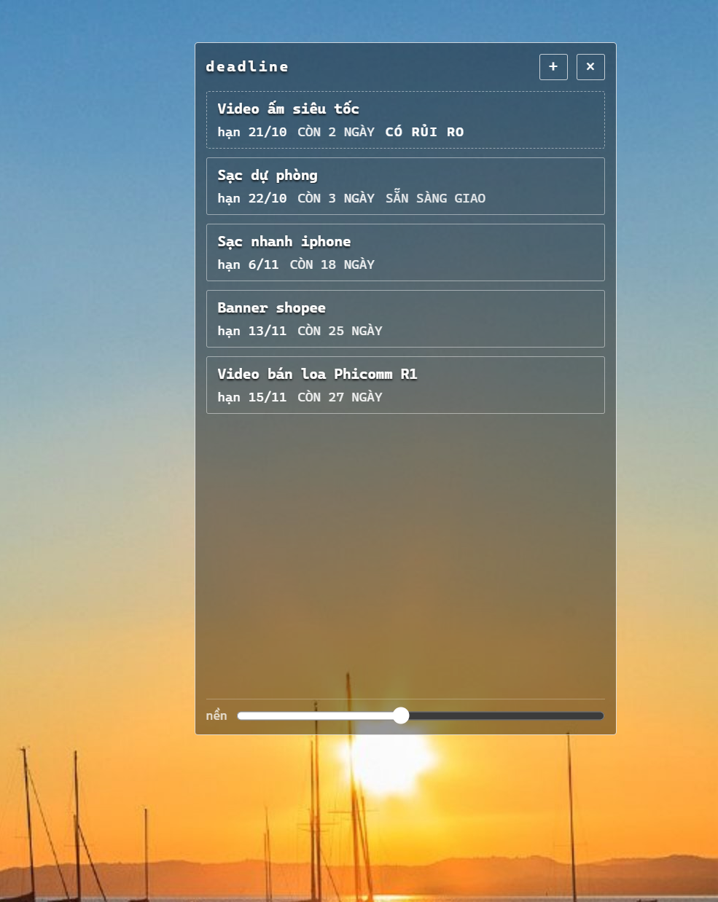
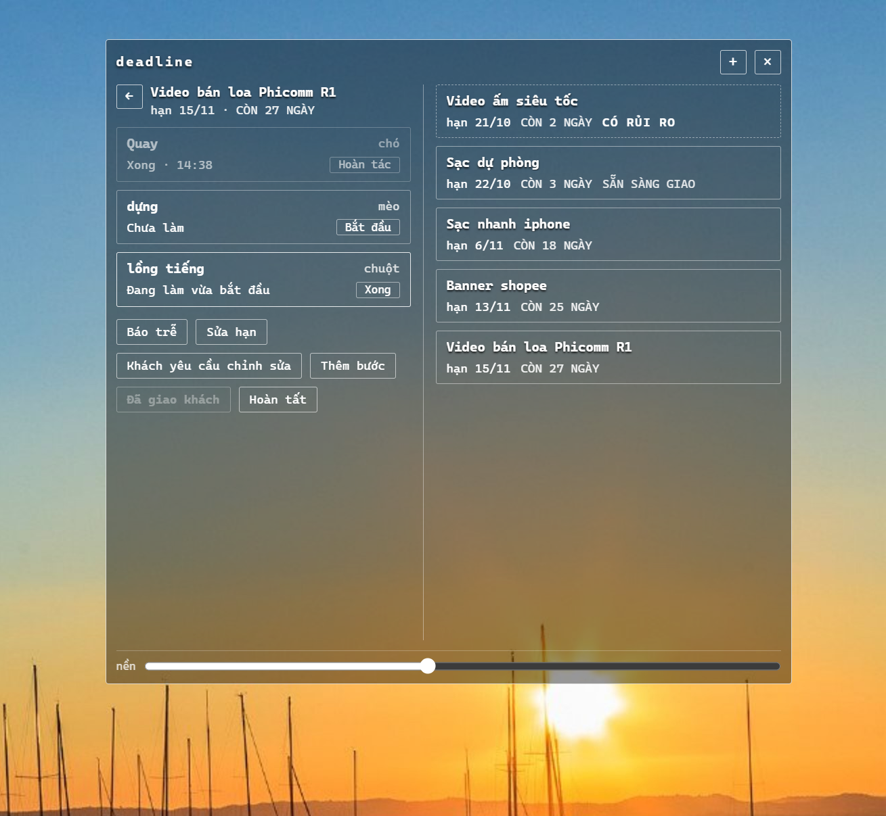
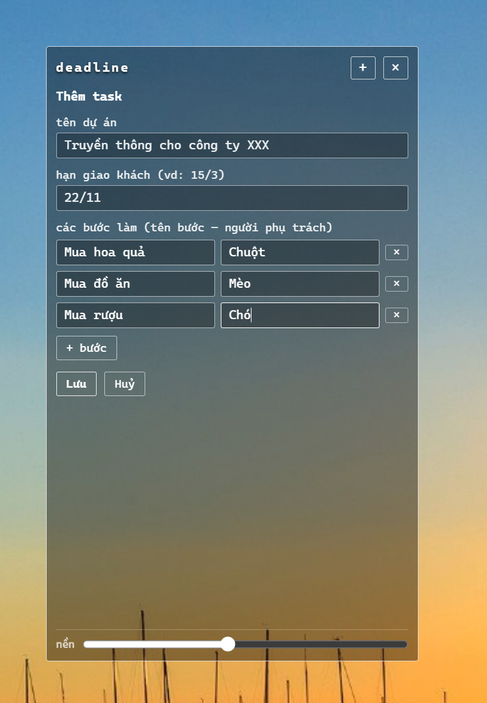
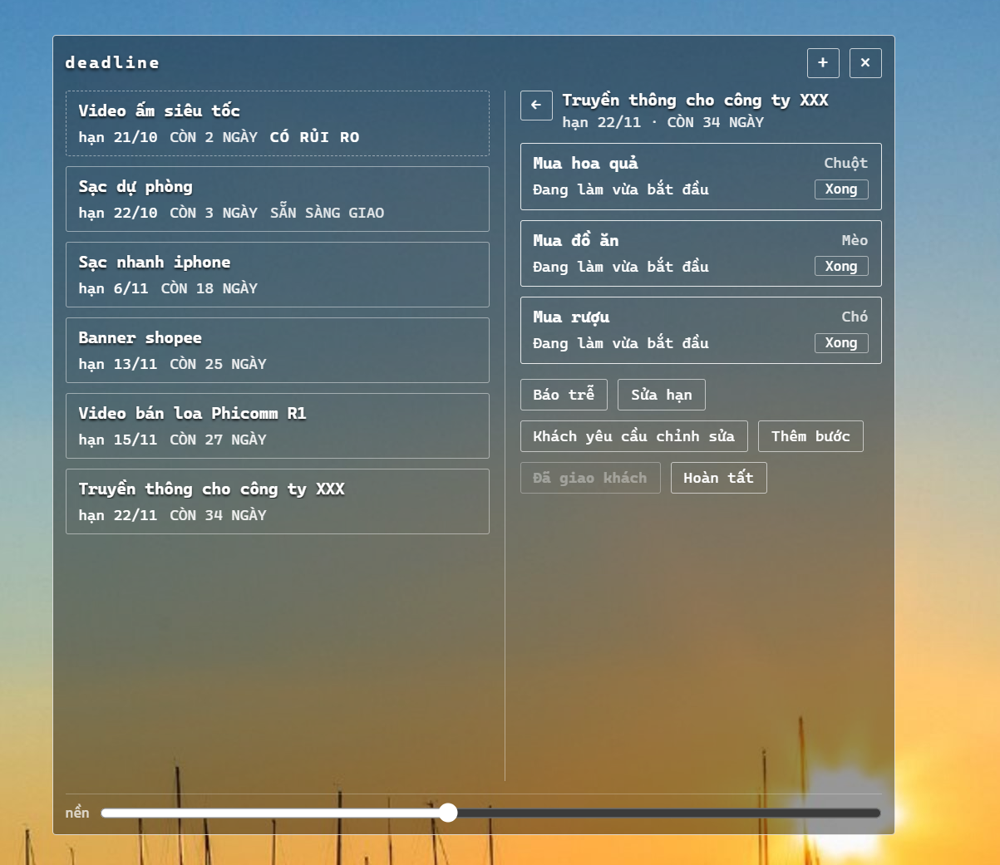

# Deadline — widget quản lý deadline

Widget desktop nhẹ cho account manager: **quản lý task theo hạn giao khách** với thẩm pháp mono (trắng/đen/xám, nền trong suốt).

  
  

  
  

  

## Tính năng

- **Nút lơ lửng** trong suốt trên desktop, không chiếm chỗ taskbar.
- **Bảng xếp hạng**: task sắp đến gần nhất đứng đầu, quá hạn lên trên cùng, task có rủi ro chen lên trước tất cả.
- **Pipeline từng người**: bấm vào task để theo dõi từng bước ai đang làm, ai xong, ai chưa làm (tự tính phút).
- **Hạn giao khách**: nhập tự do kiểu `15/3` (năm tự suy) hoặc `15/3/2027` — chấp nhận dấu `/`, `-`, `.`, khoảng trắng.
- **Vòng chỉnh sửa**: khách yêu cầu sửa → thêm vòng mới (Chỉnh sửa lần N) + hạn nộp lại.
- **Thẩm pháp mono**: trắng/đen/xám, viền 1px, nền trong suốt + scrim nhẹ; khẩn cấp = chữ đậm + nhãn, không dùng màu.
- **Cỡ chữ**: nút **−** / **+** ở đáy bảng tăng giảm cỡ chữ (80%–160%); các ô bao quanh chữ tự phóng to theo, không bị xuống dòng.
- **Shortcut desktop**: chạy `make-shortcut.bat` một lần để tạo shortcut trên desktop.

## Chạy (từ mã nguồn)

- Cần Node.js. Bấm đúp `run.bat` (lần đầu chạy `npm install` trước), hoặc mở terminal trong thư mục này gõ `npm start`.

## Tải bản chạy trực tiếp

- **Bản portable**: [deadline-0.1.0-portable.exe](https://github.com/huybibi/deadline/releases/download/v0.1.0/deadline-0.1.0-portable.exe) (~100MB) — tải về, bấm đúp chạy luôn.

## Dùng hằng ngày

- Bấm nút → mở bảng. Bấm **+** → thêm task: tên dự án, hạn giao khách (vd: `15/3`), các bước + người phụ trách (thêm bớt bước tuỳ dự án).
- Bấm vào task → từng bước có nút **Bắt đầu / Xong**, nhấn nhầm thì **Hoàn tác**. Cần việc phát sinh sau khi tạo task → **Thêm bước** ngay trong trang chi tiết.
- **Báo trễ** → task nhảy lên đầu với nhãn CÓ RỦI RO → gọi khách xin lùi → bấm **Sửa hạn** → mọi thứ tự sắp lại.
- Khách yêu cầu chỉnh sửa → **Khách yêu cầu chỉnh sửa**: thêm vòng sửa mới (Chỉnh sửa lần N, nhiều người nếu cần) + hạn nộp lại.
- Xong hết bước → nút **Đã giao khách** mở khoá → task xuống mục "Đã giao — chờ phản hồi". Khách muốn sửa → bấm "Khách muốn sửa".
- **Hoàn tất** → ẩn task vĩnh viễn. **Xoá** trên dòng → xoá hẳn (phải bấm xác nhận).

## Phím & điều khiển

- **Kéo nút**: giữ chuột trái trên nút và rê.
- **Kéo bảng**: nắm vào thanh tiêu đề "deadline" phía trên.
- **Đổi kích thước bảng**: nắm vào mép hoặc góc bảng và kéo; bố cục bên trong tự căn lại (kích thước được nhớ cho lần sau).
- **Thanh nền**: dưới đáy bảng, kéo để chỉnh độ mờ/đậm của nền bảng (được nhớ cho lần sau).
- **Ctrl+Alt+D**: ẩn / hiện widget (khi ẩn vẫn chạy ngầm).
- **Icon khay hệ thống** (góc phải taskbar): bấm trái để ẩn/hiện; chuột phải có menu **Hiện/Ẩn**, **Thoát** — thoát hẳn app từ đây.
- **Esc**: thu về nút; đang nhập form thì phải bấm Esc 2 lần (tránh mất nội dung).
- **Chuột phải trên nút**: menu Ẩn / Thoát.

## Dữ liệu

- Lưu tại `%APPDATA%\deadline\tasks.json` — app tự tạo bản phòng hờ `tasks.json.bak` mỗi lần ghi.
- Backup: copy file trên (cùng thư mục có `position.json` — vị trí nút + kích thước bảng, và `settings.json` — độ đậm nền) sang nơi khác.
- Xoá app không mất dữ liệu; muốn mang sang máy khác chỉ cần chép lại file.

## Phát triển

- `npm start` — chạy app từ mã nguồn.
- `npm test` — chạy unit test.
- `node scripts/e2e.js` — chạy E2E test.
- `npm run dist` — đóng gói portable .exe.

## Giấy phép

Dự án cá nhân cho huybibi — account manager tiếng Việt.
